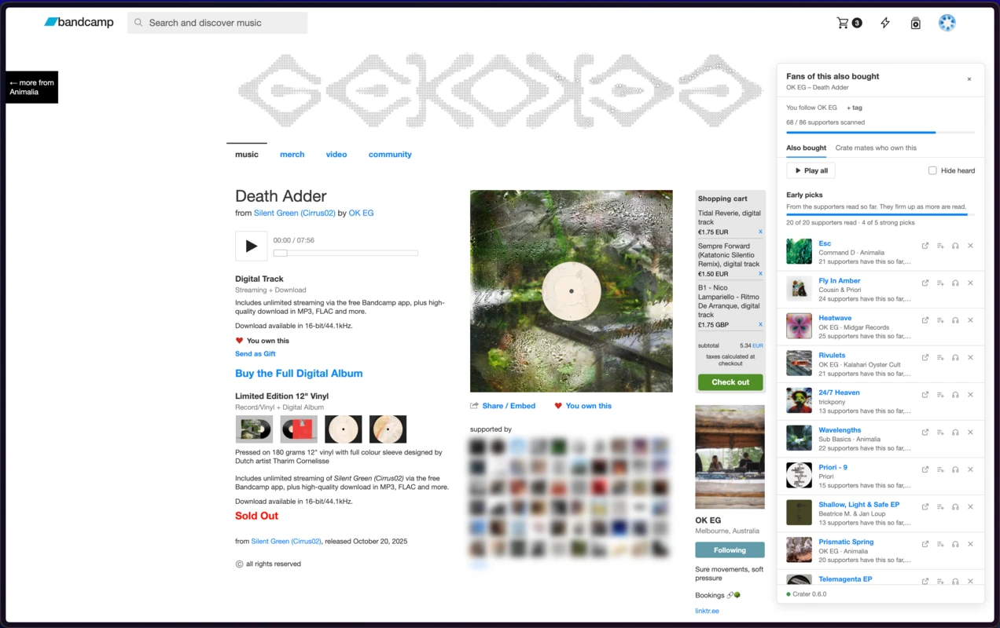
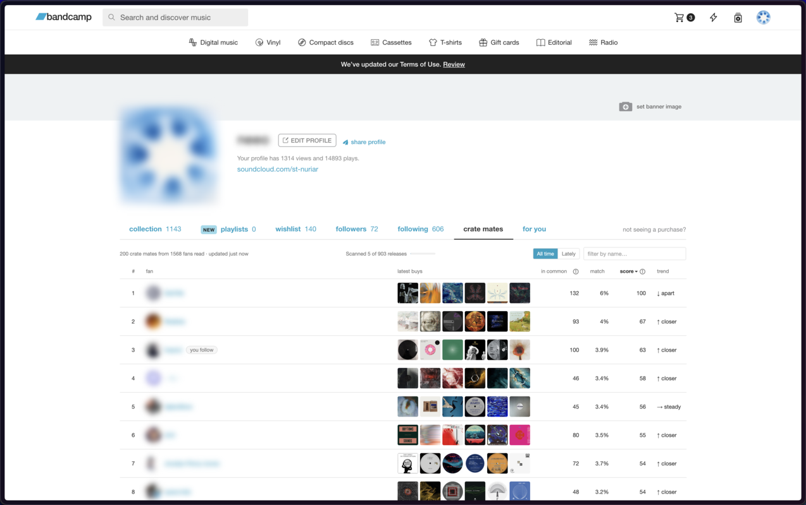
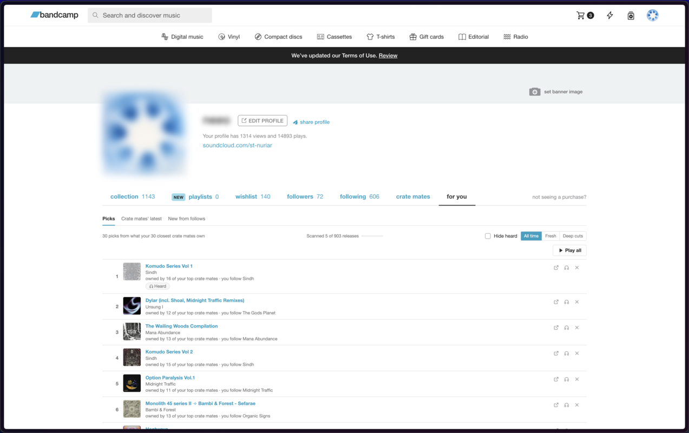
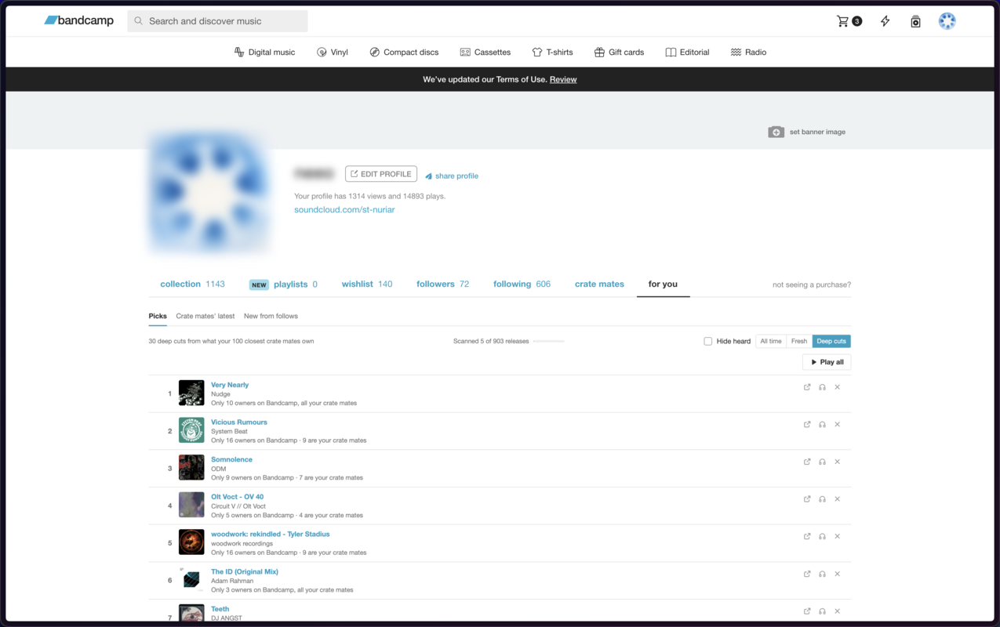
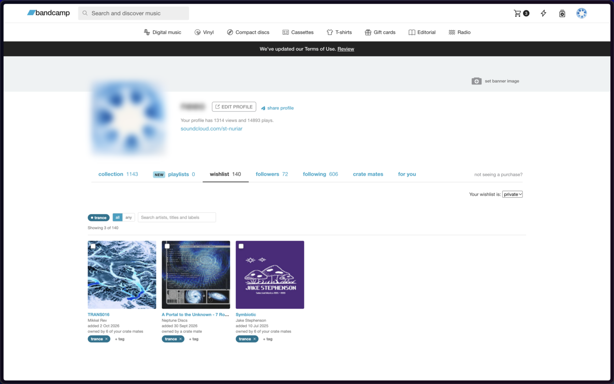

<p align="center">
  
</p>

<h1 align="center">Crater</h1>

<p align="center">
  <b>Music discovery for Bandcamp, built from what real fans actually bought.</b><br>
  For Chrome and Firefox. No account, no server, no tracking: everything stays in your browser.
</p>

<p align="center">
  <a href="https://chromewebstore.google.com/detail/crater-%E2%80%93-music-discovery/jnanpoeopeedaedanphfddhhipebaaek"></a>
  <a href="https://addons.mozilla.org/en-US/firefox/addon/crater-bandcamp/"></a>
  <a href="https://github.com/ninoman/crater/releases/latest"></a>
  <a href="LICENSE"></a>
</p>

Crater looks at the collections of people who bought the music you love and turns them into recommendations right inside Bandcamp. No algorithms trained on streams, no sponsored picks: just purchases.

## Features

### Also bought

On any album or track page, a sidebar shows what other buyers of that release also own, ranked by how strongly they're connected, not just by how popular a release is. Small releases fall back to the same label and artist.



### Crate mates

A new tab on your profile ranks the fans whose collections overlap yours the most. Switch between **All time** and **Lately** to see who shares your taste right now, with trends and "this year" counts. On other fans' pages you'll see where they rank: *your #4 crate mate · 37 in common*.



### For you

A second profile tab with three parts:

- **Picks:** releases your crate mates own and you don't. *All time* gives the strongest picks from your closest crate mates, *Fresh* what they've bought recently, and *Deep cuts* rare releases with only a handful of owners.
- **Crate mates' latest:** a feed of what your top crate mates just bought.
- **New from follows:** new releases from the artists and labels you follow, newest since your last visit first. Filter by tag, mute accounts, and turn on a desktop notification if you like.





### Listen as you dig

Preview any pick from its cover, or press **Play all** and work through a whole list with next, previous and keyboard shortcuts. Anything you've heard gets a mark, and you can hide heard releases from any list.

### Tags for follows and wishlist

Tag the artists, labels and fans you follow and the releases on your wishlist, then filter by tag or tag many at once. Heart a release or follow an account and the tag picker opens right there. Tags show on each artist's and release's own page, and stay with a release after you buy it.



### And more

- **Page badges** (optional): small markers next to release links show what you own, what's on your wishlist and how many crate mates have it.
- **Smarter picks:** artists and labels you follow get a gentle boost, compilations are down-weighted, and you can hide any release, artist or label in one click.
- **Fast wishlist and follows:** both tabs fill in during your first sync and stay quick with thousands of items.
- **Your data, your call:** pause or resume scanning, export your wishlist, collection or picks as CSV, back up and restore the whole database, and clear everything at any time.

## How it works

1. Open Bandcamp while signed in. Crater syncs your collection, wishlist and follows.
2. In the background it slowly reads the public collections of fans who bought the same releases as you, at a polite pace with a daily request limit.
3. Recommendations get better the more you browse: every release page you open is scanned first.

Everything is stored locally in IndexedDB. Crater only talks to Bandcamp. See the [privacy policy](docs/privacy.md).

## Install

- **Chrome** (and other Chromium browsers): [Chrome Web Store](https://chromewebstore.google.com/detail/crater-%E2%80%93-music-discovery/jnanpoeopeedaedanphfddhhipebaaek)
- **Firefox:** [Firefox Add-ons](https://addons.mozilla.org/en-US/firefox/addon/crater-bandcamp/)

Then open [bandcamp.com](https://bandcamp.com) while signed in.

## Other Bandcamp extensions I use

Crater does discovery. These two cover other parts of digging, and work fine alongside it:

- **[Bandcamp Tempo Adjust](https://chromewebstore.google.com/detail/bandcamp-tempo-adjust/iniomjoihcjgakkfaebmcbnhmiobppel)**: change playback speed, see the BPM of tracks on album pages.
- **[Batchcamp](https://chromewebstore.google.com/detail/batchcamp-bulk-bandcamp-d/jfcffbaekgnenlohblfgpohgdhalgjeb)**: select many releases from your collection and download them in one go, in any format Bandcamp offers.

## Development

Stack: TypeScript, Vite + CRXJS, React, Dexie (IndexedDB), Vitest, Biome.

```bash
pnpm install
pnpm dev      # build in watch mode, then load dist/ unpacked
pnpm test
pnpm build
```

- [ROADMAP.md](ROADMAP.md): the build plan and what's done
- [docs/decisions.md](docs/decisions.md): findings and design decisions
- [docs/releasing.md](docs/releasing.md): how releases are cut

## License

[MIT](LICENSE). Crater is an independent project and isn't affiliated with Bandcamp.
